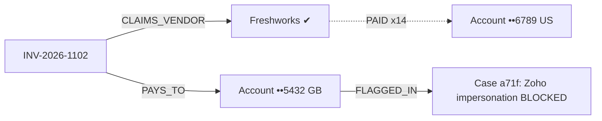

# PayeeGuard — Master Spec v3 (single source of truth)

ContextCon 03 · IIT Bombay · Agentic Services Hackathon · Sat Oct 31, 2026
Team of 3 (Yaksh, Aditya, Bahul) · Repo: https://github.com/yakshbhesaniya/PayeeGaurd

> v3 replaces v1 and v2.1. This is the only spec; earlier docs were removed.
> Every teammate pastes sections 1–17 into `CLAUDE.md` before writing code.
> **Hackathon rule: no code before 10:30.** Docs, sample texts and API exploration with curl are allowed prep.

---

## 0. TL;DR

**PayeeGuard is an autonomous accounts-payable trust desk.** It takes any invoice or bank-change email it has never seen and does four things:

1. **Resolves who is really involved** through Crustdata's company and people graph: vendor → `crustdata_company_id`, sender → `crustdata_person_id`, with employment timeline.
2. **Follows the money** through our own payment-trust graph: bank accounts, historical payments, past fraud cases.
3. **Investigates.** A deterministic Fraud Pattern Investigator names the most likely attack and states what it ruled out, citing a source for every fact.
4. **Finishes the job.**
   - **PAY:** a simulated payment through a payment gate, plus a Watcher on the vendor.
   - **HOLD:** a callback script and verification email to an *independently sourced* contact, plus an exception ticket.
   - **BLOCK:** a complaint-ready case file that links related attempts into one campaign.

**One-line pitch:** *PayeeGuard is the trust check every human or AI accounts-payable agent runs before money moves.*
**Demo line:** *"Every identity check passed. The money trail didn't."*

### What changed from v2.1

| Area | v2.1 | v3 |
|---|---|---|
| Model | 16 independent checks adding points | **Facts on a payment-trust graph** + **Fraud Pattern Investigator** (named attack, ruled-out hypotheses) |
| Missing data | Sometimes added risk (C3 "not found" +20, C1 "no match" + bank change = BLOCK) | **Never adds risk.** It lowers *verification confidence* → HOLD, never BLOCK |
| Scoring | Sum of all signals (double counting) | **Risk** = sum of per-family *maximums*; **Confidence** = HIGH/MEDIUM/LOW from 3 critical facts |
| Bank change | +10 points | **Policy: never auto-paid**, always at least HOLD with an independent callback |
| Account fingerprint | sha256(SWIFT + last4), which collides | **HMAC-SHA256(secret, full account)**; last-4-only is "weak" and never hard-blocks |
| Shared account | Hard block | **Hard block only if tied to a blocked case**; shared with another *approved* vendor = HOLD (could be factoring/aggregator) |
| Prompt injection | "irrelevant" | **Server re-derives critical fields from raw text**; a disagreement with Claude is evidence |
| Signatory | found / not found | **Employment timeline**: current employee (confirms), ex-employee (risk), role authority |
| Demo hero | lookalike domain | **Real vendor, real domain, real office, and still blocked by the graph** |
| Cut | — | agent marketplace, adverse-media web search, HTML report, CI, 18-sample eval → P2 / cut |

---

## 1. Hackathon context and what wins

- **Brief:** pick a paid job and build agents that do *all* of it. Humans only for exceptions; every decision cites its reasons; five hours.
- **Due at 15:30 code freeze:** the repo, plus a demo video of the product taking a request it has never seen all the way to finished work.
- **Judges:** Crustdata (Yashwant Akash, Rishabh Raj) want *meaningful use of identity resolution and relationships*. IIT Bombay professors want *rigour*: no absence-of-evidence errors, no double counting, reproducibility, honest evaluation.
- **Criteria:** end-to-end execution · data integrity and verification · robustness and edge cases · demo clarity.
- **Format:** free. "A single agent, a system of agents, an MCP server or a CLI." We ship **one service agent** (Claude orchestrating PayeeGuard through MCP) with deterministic investigators, plus a CLI.

---

## 2. Problem statement

**Submitted statement (100 words, unchanged):** Vendor impersonation and fake-supplier invoices are among the most costly B2B frauds, and as AI agents begin paying invoices autonomously, few tools verify who is being paid. Today, accounts-payable teams check vendors manually, slowly, or not at all. PayeeGuard is an autonomous agent that takes any unseen invoice or bank-change email, extracts the payee details, and verifies them against Crustdata's people and company graph: does the vendor exist, does the sender's domain match, does the signatory actually work there, and does the company show shell-company signals? It returns PAY, HOLD, or BLOCK with a cited evidence ledger for every claim.

**Why it matters:**

- Two in five businesses have been hit by invoice fraud, averaging $367,000 per incident; only a quarter have automated defences ([Ivalua, Sept 2026](https://www.ivalua.com/press-releases/two-in-five-businesses-fall-victim-to-invoice-fraud-with-losses-averaging-367000/)).
- Vendor impersonation is the most common tactic behind business email compromise ([AFP 2026 survey via Beancount](https://beancount.io/blog/2026/07/20/ai-fake-invoice-fraud-accounts-payable-guide)).
- Paid humans do this today: AP clerks, vendor-master teams, payment-fraud analysts, audit firms.
- **Differentiator:** banking checks (Confirmation of Payee, penny drop) confirm an account belongs to *a* name. PayeeGuard checks whether the **request** is legitimate: who sent it, whether they work there, and whether this vendor has ever been paid to this account. It complements banking checks rather than replacing them.

---

## 3. The service and the agent design

```
 INTAKE          RESOLVE (Crustdata)        FOLLOW THE MONEY (our graph)     INVESTIGATE + DECIDE          FINISH THE WORK            LEARN
 raw email  ──▶  vendor → company_id   ──▶  account vs vendor history   ──▶  facts → pattern investigator ─▶ PAY: gate + watcher   ──▶ graph edges
 (never seen)    sender → person_id         account vs other vendors         → risk + confidence            HOLD: callback, email,     audit log
 + regex         employment timeline        account vs blocked cases         → PAY / HOLD / BLOCK             ticket → human
 cross-check     domains, offices           invoice no. vs paid invoices                                    BLOCK: case file
```

- **One service agent.** Claude reads messy input, calls `verify_payee`, presents the result and may call `pay_invoice` / `resolve_case`.
- **Investigators** are deterministic Python modules (company, channel, signatory, payment/graph, behaviour). On stage call them "investigators", not "agents".
- **Agent marketplace** (scripted buyer, seller and attacker agents): **P2, cut by default.** It's a circular evaluation and a time sink. Build it only if everything else is done.
- **Out of scope** (say so if asked): moving real money, sending emails or calling anyone (all outbound is DRAFT/SIMULATED); bank-registry account validation; sanctions lists; a web app.
- **Done means:**
  - all 10 samples hit their expected verdict and attack type;
  - every ledger row and graph edge has a citation;
  - no unhandled exception on missing data or API failure;
  - the ablation table is generated.

---

## 4. Architecture

Claude extracts and orchestrates. **Python decides**: the same input always gives the same verdict.

```
      Claude Desktop / Claude Code (MCP client)                         cli.py (no LLM)
                 │ verify_payee(raw_text, ...fields)                          │
                 ▼                                                            ▼
          server.py (FastMCP) ── extract.py re-derives critical fields from raw_text; mismatches → evidence
                 │
                 ▼
          pipeline.py ── ctx {company, company_id, person, vendor_known, ...}
    ┌────────────┼─────────────────┬──────────────────────┬──────────────────┐
 checks_company  checks_channel    checks_signatory        checks_payment     checks_behaviour
 C1 C4 C5 C6cb   C2 C2b C8 C10     C3 (timeline, role)     G1–G4 C9 C11       C14 urgency
    │               │                  │                       │
    └─────── client.py (Crustdata: cache, retry, buckets, counters) ── graph.py (SQLite nodes/edges + citations)
                                                                           │
          scoring.py (families → risk, confidence → decision) ◀────────────┘
          investigator.py (patterns → hypothesis + ruled-out)
          actions.py (finished work) · report.py (md + json + mermaid) · gate.py (pay/resolve) · audit.py
```

---

## 5. Shared data contracts (frozen at 10:30)

`payeeguard/models.py`. Change only by announcing it in the team chat; Yaksh edits.

```python
from dataclasses import dataclass, field
from typing import Literal, Optional

@dataclass
class Invoice:
    vendor_name: Optional[str]
    vendor_domain: Optional[str]          # domain claimed in the body, e.g. "freshworks.com"
    sender_email: Optional[str]
    sender_name: Optional[str]
    sender_title: Optional[str]
    remit_country: Optional[str]          # ISO-2
    vendor_address: Optional[str]
    amount: Optional[float]
    currency: Optional[str]               # ISO-4217
    bank_change_requested: bool = False
    urgency_language: bool = False
    raw_text: str = ""
    invoice_number: Optional[str] = None
    invoice_date: Optional[str] = None
    reply_to_email: Optional[str] = None
    return_path_email: Optional[str] = None
    bank_iban: Optional[str] = None       # in memory only; never logged or persisted raw
    bank_account: Optional[str] = None    # non-IBAN account number; same rule
    bank_swift: Optional[str] = None      # or IFSC for India
    bank_account_last4: Optional[str] = None

Status = Literal["verified", "contradicted", "unchecked"]
Family = Literal["CHANNEL", "SIGNATORY", "COMPANY", "PAYMENT", "BEHAVIOUR", "INTEGRITY", "CONTEXT"]
Fact = Literal["who", "channel", "money"]

@dataclass
class Evidence:
    check: str                            # e.g. "C2_domain", "G3_account_flagged"
    family: Family
    claim: str                            # "Sender domain belongs to the vendor"
    status: Status
    detail: str                           # what we found, plain English
    source: str                           # citation (section 5.1)
    weight: int = 0                       # risk points, only when contradicted
    hard_block: bool = False
    unchecked_reason: Optional[str] = None  # "api_error" | "not_enabled" | "no_data" | "not_applicable"
    confirms: Optional[Fact] = None       # set on verified rows that confirm a critical fact

@dataclass
class Hypothesis:
    attack_type: str                      # see section 9
    title: str                            # "Compromised vendor mailbox"
    narrative: str                        # 2-3 sentences built only from cited facts
    supporting: list[str] = field(default_factory=list)  # Evidence.check ids

@dataclass
class RuledOut:
    attack_type: str
    because: str                          # "sender domain is in Freshworks' all_domains"
    source: str

@dataclass
class Action:
    kind: Literal["payment_instruction", "watcher", "callback_script", "verification_email_draft",
                  "exception_ticket", "fraud_case_file", "do_not_pay_notice", "kyb_onboarding_task"]
    title: str
    body: str
    path: Optional[str] = None
    simulated: bool = True

@dataclass
class Verdict:
    decision: Literal["PAY", "HOLD", "BLOCK"]
    risk_score: int                       # 0-100
    confidence: Literal["HIGH", "MEDIUM", "LOW"]
    evidence: list[Evidence] = field(default_factory=list)
    hypothesis: Optional[Hypothesis] = None
    also_matched: list[Hypothesis] = field(default_factory=list)
    ruled_out: list[RuledOut] = field(default_factory=list)
    decision_rule: str = ""               # which rule in section 10.4 fired, e.g. "R1 hard fact G3"
    company_id: Optional[int] = None
    person_id: Optional[int] = None
    callback: Optional[str] = None
    summary: str = ""
    case_id: str = ""                     # sha256(normalised raw_text)[:12]
    actions: list[Action] = field(default_factory=list)
    graph_edges: list[dict] = field(default_factory=list)   # for the Mermaid picture
    crustdata_calls: int = 0
    crustdata_credits: float = 0.0
```

### 5.1 Citation formats

- Company: `crustdata:company/<crustdata_company_id>#<field.path>`
- Person: `crustdata:person/<crustdata_person_id>#<field.path>`
- Search: `crustdata:person/search?company_website_domain=<d>&name=<n> -> total_count=<k>`
- No match: `crustdata:company/identify?domains=<v> -> no match`
- Web: the URL · RDAP: `rdap:<domain>#events.registration` · DNS: `dns:<domain>#MX`
- Graph: `graph:<rel>/<src>-><dst>@case:<case_id>`, e.g. `graph:FLAGGED_IN/account:9be1…->case:a71f…`
- Extraction: `extract:regex#<field>` vs `extract:llm#<field>`

**Rules:**

1. A check that can't run returns `unchecked` with a reason, **never** `contradicted`.
2. **Absence of a record is never a contradiction.** Only a positive conflicting fact is.

---

## 6. Crustdata integration (checked against docs.crustdata.com)

Base `https://api.crustdata.com`. Headers on every call:

```
authorization: Bearer $CRUSTDATA_API_KEY
x-api-version: 2025-11-01
content-type: application/json
```

| Endpoint | Path | Body | Used by | Cost / limit |
|---|---|---|---|---|
| Credits | `GET /user/credits` → `{"credits":196.54}` (also `GET /account/credits` for wallet detail) | — | report footer | free ✅ tested |
| Usage | `GET /account/usage/summary` | — | debugging | free ✅ tested |
| Permissions | `GET /permissions` returns **404** on our key; skip it | — | — | — |
| Company Identify | `POST /company/identify` | `{"domains":["x.com"],"exact_match":true}` or `{"names":["X"]}` | C1 | free ✅ tested |
| Company Enrich | `POST /company/enrich` | `{"crustdata_company_ids":[id],"fields":["basic_info","headcount","locations","web_traffic"]}`; **do NOT request `people` by default** (6 MB response for Freshworks: 300 decision makers) | C1, C4, C5 | 2 credits · **15/min** ✅ tested |
| Person Identify | `POST /person/identify` | `{"emails":["a@x.com"]}` | C3 | ❌ **403 permission_error on our key**: C3 goes straight to Person Search; client caches the 403 |
| Person Search | `POST /person/search` | filter tree, `limit`, `fields:["basic_profile","experience"]` | C3, insider | ~0.2 credits/result with these fields · **30/min** ✅ tested |
| Web Fetch | `POST /web/enrich/live` | `{"urls":[...]}` ≤ 10 → `[{"success","url","timestamp","title","content"(HTML),"http_status"}]` | C6 callback | ~1 credit ✅ tested |
| Web Search | `POST /web/search/live` | `{"query":"site:<domain> contact","sources":["web"]}` | C6 fallback only | 1 credit |
| Company Watcher | `POST /watch/company` (+ `/watch/company/{id}/test`, free) | section 7 C7 | C7 (P1) | baseline free; 5 credits/change |
| Person Watcher | `POST /watch/person` | `entities.professional_network_profile_urls` only | C7 (P1) | 5 credits/change at 30-day freshness |

**Response facts we rely on (documented):**

- Identify/Enrich return a **top-level array**: `[{"matched_on","match_type","matches":[{"confidence_score","company_data"|"person_data"}]}]`. Empty `matches` = no match.
- Company: `basic_info.{name,primary_domain,all_domains,website,year_founded,employee_count_range}`, `headcount.total`, `locations.{country,headquarters,all_office_addresses}`, `people.{founders,decision_makers,cxos}[]` (each with `crustdata_person_id`, `basic_profile`). Unrequested sections are `null`; request whole groups.
- Person (✅ tested via Person Search): `crustdata_person_id`; `basic_profile.{name,headline,current_title,normalized_title,location}`; `experience.employment_details.current[]` and `.past[]`, each with `name`, `title`, `crustdata_company_id`, `start_date`, **`end_date`** (null for current), **`function_category`**, **`seniority_level`**, `company_website`, `business_email_verified`, `years_at_company`. Note: the response has `company_website`, not `company_website_domain` (that name is only a *filter* field).
- **`past[]` can contain the same company** (an earlier role before a promotion). Ex-employee = vendor in `past[]` **and not** in `current[]`.
- Company `locations.country` is a name like `"USA"`, not ISO. `all_office_addresses` entries **end with an ISO-2 code** (`"…, EC1N 8JS, GB"`), so use those for C5 and normalise `country` with `geo.py`.
- Person Search filters: `experience.employment_details.current.company_website_domain`, `experience.employment_details.company_name` (current or past), `experience.employment_details.current.title`, `basic_profile.name`, `crustdata_person_id`. Operators include `in` (exact, array) and `(.)` (word match). Response `{"profiles":[...],"next_cursor","total_count"}`.

**Credit budget ✅:** balance **15,196.54 credits** (event wallet 14,996.54 + 200 grant expiring 2026-11-14), checked at ~10:15. Credits are not a constraint. Per invoice: Identify 0 + Enrich 2 + Person Search ~0.5–1 + Web Fetch ~1 (cached per vendor) ≈ **3–4 credits for a new vendor, ~0 for a cached one**. **The cache is mandatory from the first call.** Every teammate shares cached responses via the committed `.cache/` at merges, and nobody re-runs uncached loops.

### 6.1 Live verification at 10:00–10:30 (Yaksh runs; paste results in the team chat and into section 6.2)

```bash
crust() { curl -s "https://api.crustdata.com$1" -H "authorization: Bearer $CRUSTDATA_API_KEY" \
  -H "x-api-version: 2025-11-01" -H "content-type: application/json" "${@:2}"; }
crust /user/credits
crust /company/identify -X POST -d '{"domains":["freshworks.com"],"exact_match":true}'
crust /company/identify -X POST -d '{"domains":["zoho.com"],"exact_match":true}'
crust /company/enrich -X POST -d '{"crustdata_company_ids":[6042422],"fields":["basic_info","locations","headcount"]}'
crust /person/search -X POST -d '{"filters":{"op":"and","conditions":[{"field":"experience.employment_details.current.company_website_domain","type":"in","value":["freshworks.com"]},{"field":"experience.employment_details.current.title","type":"(.)","value":"accounts receivable"}]},"limit":2,"fields":["basic_profile","experience"]}'
```

### 6.2 Verification results (fill in at 10:30)

Tested 2026-10-31 ~10:00 IST with our key.

| Question | Result |
|---|---|
| Freshworks resolves (id, confidence)? | ✅ `crustdata_company_id 6042422`, confidence 1.0, name "Freshworks", founded 2010, Public Company, 1001-5000 range, `headcount.total` 7859 |
| Zoho resolves (id, confidence)? | ✅ `crustdata_company_id 1032449`, confidence 1.0, name "Zoho", founded 1996, HQ Chennai |
| Freshworks `all_domains` | `["freshworks.com"]` only (Zoho: `zoho.to`, `zoho.com.cn`, `zoho.com`) |
| Freshworks office countries (is GB there?) | ✅ **GB (London, Hatton Garden)**, US (San Mateo HQ, Bellevue, Denver), FR, DE, IN (Chennai, Hyderabad). The hero story works as written |
| `past[]` entries have `end_date`? | ✅ yes (`null` on current roles); also `function_category`, `seniority_level` |
| Freshworks finance team visible? | ✅ Person Search (current domain freshworks.com + title "accounts receivable") `total_count` 15 |
| Person Identify enabled on our key? | ❌ 403 `permission_error` |
| Web Fetch path and cost | ✅ `POST /web/enrich/live`, ~1 credit; `https://www.freshworks.com/company/contact/` returns `http_status` 404 inside a 200 response, so check `http_status` and try fallbacks |
| Credits path | ✅ `GET /user/credits`; `/permissions` is 404 |
| Credits on our key | ✅ **15,196.54** (event credits arrived; 3.46 used by these tests) |

---

## 7. Checks, grouped by family

Each check is `check_X(inv: Invoice, ctx: dict, client, graph) -> list[Evidence]`. "Weight" applies only when the row is contradicted.

### CHANNEL: is the message really from the vendor? (Yaksh)

| Check | Verified (confirms) | Contradicted | Weight |
|---|---|---|---|
| **C2_domain** | sender's registrable domain ∈ vendor `all_domains`, or = vendor domain in our payment history (`confirms="channel"`) | **lookalike** of a vendor domain | **hard** |
| | | unrelated non-free domain | 15 |
| **C2b_freemail** | — | gmail, outlook, yahoo, proton, icloud, rediffmail… | 25 |
| **C2c_display_name** | — | display name contains an email/domain ≠ the real address (H4) | 30 (hard if the real address is a lookalike) |
| **C8_domain_age** (P1) | registered > 90 days ago | < 30 days 25 · < 90 days 15 · RDAP 404 (not registered) 25 | ≤ 25 |
| **C8_mx** (P1) | MX present | no MX | 10 |
| **C10_reply_to** (P1) | Reply-To/Return-Path domain = From domain or a vendor domain | lookalike **hard** · free/unrelated 30 | hard / 30 |

**Lookalike rule** (safe version):

- the label is ≥ 5 characters, **and** the domain is not in `all_domains` or the policy allow-list, **and** one of:
  - edit distance ≤ 1 (label < 8 chars) or ≤ 2 (label ≥ 8);
  - equal after homoglyph normalisation (0→o, 1→l, rn→m, vv→w, punycode/IDN → ASCII skeleton);
  - brand token + extra word (`freshworks-billing`);
  - same label on another TLD;
  - brand label appears as a **subdomain** of an unrelated registrable domain (`freshworks.com.secure-pay.ru`), see H3.

**Sibling domains (H5):** before calling an unrelated domain "unrelated", run Company Identify (free) on the sender's registrable domain. If it returns the same `crustdata_company_id` as C1 → C2 verified with detail "domain resolves to the same company". This is only a comparison: the sender domain never chooses the vendor.

Processors (`stripe.com`, `razorpay.com`, `bill.com`, `paypal.com`) in `policy.toml` count as verified channel only as sender or Reply-To, never as payee name.

### SIGNATORY: is the sender who they claim? (Aditya)

**C3_signatory** resolves the sender to a person, then reads the employment timeline.

1. Not free mail → Person Identify `{"emails":[sender_email]}`. **It's 403 on our key** (section 6.2): the client caches the 403 as `NotEnabled` and C3 goes straight to step 2 with no retry.
2. If no match, 403 or free mail → Person Search: `current.company_website_domain in [vendor primary_domain]` AND `basic_profile.name (.) sender_name`, `limit 5`.
3. If still nothing → Person Search: `experience.employment_details.company_name in [vendor name]` AND `basic_profile.name (.) sender_name` (catches ex-employees).

| Finding | Status | Weight |
|---|---|---|
| a `current[]` entry with `crustdata_company_id` = vendor | verified (`confirms="who"` only if C1 isn't already verified; detail gives title and `start_date`) | — |
| vendor in `past[]` (with `end_date`) **and not** in `current[]` | contradicted, "ex-employee: left Freshworks 2024-12" | 35 |
| person matched by **email** works at a different company only | contradicted | 30 |
| current employee whose `function_category` isn't finance/accounting **and** whose title has none of `policy.signatory.payments_title_keywords`, **and** bank change requested | contradicted, "role authority" | 20 |

Matching rule: compare `crustdata_company_id` (exact), never the company name. Don't use a bare "account" keyword: "Strategic Accounts" and "Account Management" are sales roles (we saw both among Freshworks decision makers).
| not found | **unchecked/no_data, 0 risk** | — |

Note: samples use invented people, so they'll show "not found" (no penalty). Timeline logic is proven by unit tests with recorded-shape fixtures; a judge can try it live with a real address.

### COMPANY: does the vendor exist and look real? (Yaksh)

- **C1_vendor:** Identify by `vendor_domain` (`exact_match`), else by `vendor_name`. Pick the best `confidence_score`. If the top two are within 0.05: prefer domain-token overlap with the sender, else **unchecked** (ambiguous) with the runner-up in detail. Match with confidence ≥ 0.8 → verified `confirms="who"`; then **one** Enrich call into `ctx["company"]`. **No match → unchecked/no_data (never contradicted).**
- **C4_shell:** contradicted (15) only if **≥ 2** of: founded ≤ 12 months, `headcount.total` ≤ 3, no web traffic. A single signal is a detail-only row.
- **C5_geo** is in PAYMENT (below).
- **C6_callback** (CONTEXT, 0 weight): one Web Fetch call (≤ 10 URLs) on the vendor's Crustdata `basic_info.website` root + `/contact`, `/contact-us`, `/company/contact`, `/about/contact`. Use the first result with `success` and `http_status` 200 (the API returns 200 even when the page is a 404, as we saw on freshworks.com). Regex out phone/email; fallback Web Search `site:<primary_domain> contact`. Fills `Verdict.callback`. **Never use contact details from the invoice.**
- **C7_watch** (CONTEXT, P1): on PAY, `POST /watch/company` on `crustdata_company_ids` tracking `basic_info.primary_domain` and `basic_info.name` `changed`; if C3 found a profile URL, `POST /watch/person` tracking `experience.employment_details.current` `added` with `keys:["crustdata_company_id","name"]`. A 403 → skip with "monitoring not enabled".

### PAYMENT: is the money going where it should? (Aditya, except C5/C11 by A)

| Check | Verified (confirms) | Contradicted | Weight |
|---|---|---|---|
| **G1_account_history** | strong fingerprint = an account this vendor was `PAID` before (`confirms="money"`); weak (last4+SWIFT) match also confirms | known vendor, account never paid before | 25 |
| **G2_account_other_vendor** | — | account `PAID` to a **different** approved vendor (factoring? aggregator? mule?) | 30 |
| **G3_account_flagged** | — | account (strong fingerprint) appears in a **BLOCKED** case | **hard** |
| **G4_duplicate** | — | same vendor + invoice no. already PAID: different account **hard**, same account 40 · same amount ±1% within 14 days (no invoice no.) 15 | hard / 40 / 15 |
| **C9_amount** | within 3× median | > 3× median of ≥ 3 prior payments | 10 |
| **G5_ambiguous_payment** | — | two or more different accounts in one email (E10) | 25 |
| **C5_geo** (A) | remit country ∈ vendor HQ/office countries (`confirms="money"` for first-time vendors only) | not in them | 20 |
| **C11_bank_format** (A) | IBAN mod-97 OK / SWIFT or IFSC format OK | IBAN checksum fails 25 · malformed SWIFT 15 · SWIFT/IBAN country ≠ stated remit country 15 | ≤ 25 |

Remit country: stated → IBAN prefix → SWIFT chars 5–6 → IFSC (→ IN).

### BEHAVIOUR (Yaksh) and INTEGRITY (Bahul)

- **C14_tactics:** quoted phrase matches. secrecy · channel_switch · authority · threat at 5 each; payment_method (crypto, USDT, gift card, personal account) 25; `urgency_language` 5. **Family sums internally, cap 25.**
- **X1_extraction:** for sender, Reply-To, IBAN/account, SWIFT and amount, regex value ≠ Claude-supplied value → contradicted 10; **regex value is used**.
- **X2_amount_conflict:** two labelled totals disagree (E8) → contradicted 10. (INTEGRITY takes the max of X1/X2.)

---

## 8. Payment-trust graph (`payeeguard/graph.py`, Aditya)

SQLite `data/graph.db`. Every edge carries its citation, so any path we show is sourced.

```sql
CREATE TABLE nodes(id TEXT PRIMARY KEY,        -- "company:123456", "person:98765", "domain:freshworks.com",
                   type TEXT, label TEXT,      -- "email:<sha1>", "account:<hmac>", "invoice:<vendor>:<no>", "case:<id>"
                   first_seen TEXT);
CREATE TABLE edges(src TEXT, rel TEXT, dst TEXT, citation TEXT, observed_at TEXT, case_id TEXT,
                   revoked_at TEXT,             -- set when a human overrides a wrong BLOCK (G-7)
                   UNIQUE(src, rel, dst, case_id));
CREATE INDEX e_dst ON edges(dst, rel);
```

| rel | src → dst | Written when | From |
|---|---|---|---|
| `OWNS_DOMAIN` | company → domain | every run (C1) | Crustdata `basic_info.all_domains` |
| `EMPLOYED_AT_CURRENT` / `EMPLOYED_AT_PAST` | person → company | C3 resolves a person | Crustdata `experience.employment_details.*` |
| `LEADS` | person → company | insider check (P1) | Crustdata `people.*` |
| `SENT` | email → invoice | every run | extractor |
| `CLAIMS_VENDOR` | invoice → company | every run | C1 |
| `PAYS_TO` | invoice → account | every run | extractor (HMAC) |
| `PAID` | company → account | **only** on PAY or human approve | gate |
| `PAID_FROM_DOMAIN` | company → domain | same | gate (history of channel) |
| `FLAGGED_IN` | account / domain / email → case | **only** on BLOCK | gate |

**Fingerprint:** `account:` + `HMAC-SHA256(PAYEEGUARD_FP_SECRET, normalised)`, where normalised = IBAN (uppercase, no spaces), or `SWIFT|IFSC + ":" + full account number`. With only last-4: `account:weak:` + sha256(SWIFT + last4). **Weak fingerprints are never used for G2/G3 hard decisions.**

**Query rules:** every query takes `exclude_case=<current case_id>` and ignores rows with `revoked_at` set (G-1, G-7). Open the DB in WAL mode.

**Queries (all deterministic):** `accounts_paid(company)`, `companies_paid(account)`, `cases_flagged(node)`, `invoice_paid(company, invoice_no)`, `edges_for_case(case_id)` (for the Mermaid picture).

**Seed (✅ written):** `samples/seed_history.json`, loaded by `python cli.py seed`.

- **Freshworks** (`6042422`): 14 monthly payments to account A (Chase, CHASUS33, US) from `freshworks.com`, invoices INV-2026-1029…1042 (including INV-2026-1031), Sep 2025 – Oct 2026, USD 4,200 (one at 4,350).
- **Zoho** (`1032449`): 6 payments to account Z (HDFC, IN), ZH-55001…55006, INR 2,10,000.

The loader resolves each domain with Company Identify (free, cached), fingerprints the accounts with HMAC, and writes `PAID` / `PAID_FROM_DOMAIN` edges with citation `seed:samples/seed_history.json`. `eval` always starts from a fresh graph (`data/eval_graph.db`) loaded from this seed.

---

## 9. Fraud Pattern Investigator (`payeeguard/investigator.py`, Bahul)

A deterministic pattern library over the evidence (by check id + status). A pattern **matches** when all *required* facts hold. Matches are ranked by a fixed priority (BLOCK-grade first, then number of supporting facts). Patterns whose *rule-out* fact holds become `RuledOut` entries quoting that fact's evidence.

| attack_type | Title | Required | Supporting | Ruled out by |
|---|---|---|---|---|
| `mule_campaign` | Account linked to a prior blocked attack | G3 contradicted | G1 contradicted, G2 | G1 verified |
| `vendor_impersonation` | Lookalike-domain impersonation | C2 or C10 lookalike | C8 young domain, C5, C14 | C2 verified **and** C10 not contradicted |
| `compromised_vendor_mailbox` | Real vendor mailbox, new payment details | C2 verified **and** (G1 contradicted or G3 or C10 contradicted) | bank change, C14, C5 | G1 verified |
| `duplicate_replay` | Already-paid invoice re-sent | G4 contradicted | G1 contradicted | — |
| `ex_employee` | Former employee requesting payment | C3 ex-employee | C2b, G1 contradicted | C3 current employee |
| `unauthorized_change` | Real employee outside payments role | C3 role-authority | G1 contradicted | — |
| `unverified_signatory` | Unverified person on a personal mailbox | C2b contradicted **and** C3 not verified | C14 channel_switch, bank change | C3 current employee |
| `unverifiable_vendor` | Vendor we can't verify (not proof of fraud) | C1 unchecked/no_data | C4, C8, C2b | C1 verified |
| `payment_method_fraud` | Off-rails payment request | C14 payment_method | — | — |
| none | No attack pattern detected | nothing contradicted | — | — |

The narrative is a template filled only with cited facts. Example:
*"The email comes from Freshworks' real domain (freshworks.com ∈ all_domains), but asks for payment to an account Freshworks has never been paid to in 14 prior payments, and the same account was used in case a71f (Zoho impersonation) 3 minutes ago. This pattern indicates a compromised vendor mailbox used in a mule-account campaign."*

---

## 10. Decision engine: risk vs verification confidence (`payeeguard/scoring.py`, Bahul)

### 10.1 Principles

1. Only **positive contradictions** add risk; unknowns lower confidence.
2. **One fact counts once:** each family contributes its **maximum** weight (BEHAVIOUR sums internally, capped at 25).
3. **Payment-instruction changes are never auto-paid.**
4. **Fail safe:** low confidence → HOLD (with the work done), never BLOCK.
5. **BLOCK needs proof:** a hard fact or high combined risk.

### 10.2 Risk

```
risk = min(100, max(CHANNEL) + max(SIGNATORY) + max(COMPANY) + max(PAYMENT) + min(25, Σ BEHAVIOUR) + max(INTEGRITY))
```

### 10.3 Confidence (three critical facts)

- **who:** C1 verified (≥ 0.8), or the vendor is known in the graph (has `PAID` edges).
- **channel:** C2 verified (sender domain ∈ `all_domains` or ∈ `PAID_FROM_DOMAIN` history).
- **money:** G1 verified; or, for a first-time vendor, C5 verified and C11 not contradicted.

HIGH = 3 confirmed · MEDIUM = 2 · LOW ≤ 1.

### 10.4 Decision (first matching rule wins; record it in `Verdict.decision_rule`)

| Rule | Condition | Decision |
|---|---|---|
| R1 | any `hard_block` evidence | **BLOCK** |
| R2 | risk ≥ 60 | **BLOCK** |
| R3 | `bank_change_requested`, or G1 contradicted, or G5 ambiguous accounts, or amount missing / ≤ 0 / credit note (E7, E10) | at least **HOLD** |
| R4 | risk ≥ 25 | **HOLD** |
| R5 | confidence HIGH | **PAY** |
| R6 | confidence MEDIUM and amount ≤ `policy.auto_pay_limit_usd` (static FX: USD 1, EUR 1.08, GBP 1.27, INR 0.012) | **PAY** |
| R7 | otherwise (MEDIUM above the limit, or LOW) | **HOLD**; if LOW because of `api_error`, the summary says "could not verify: do not pay until checks run"; if C1 no_data, add a `kyb_onboarding_task` action |

### 10.5 Expected outcomes (encode as `tests/test_scoring.py`)

| Sample / scenario | Key facts | Risk | Conf | Rule | Verdict |
|---|---|---|---|---|---|
| 01 legit Freshworks | C1 ✔ C2 ✔ G1 ✔ | 0 | HIGH | R5 | **PAY** |
| 02 lookalike, Nigeria | C2 lookalike | — | — | R1 | **BLOCK** |
| 03 Gmail "Finance Manager", new HDFC account | C2b 25, C3 no_data, channel_switch 5, bank change | 30 | LOW | R3 | **HOLD** |
| 04 Freshworks real domain, new UK account, no graph hit | G1 25 (+ C5 20 if no GB office) | 25–45 | HIGH | R3 | **HOLD** + callback |
| 05 Zoho lookalike → account M | C2 lookalike | — | — | R1 | **BLOCK** (writes `FLAGGED_IN` M) |
| 06 **hero**: Freshworks real domain → account M | C1 ✔ C2 ✔ C5 ✔ · G3 hard · G1 25 | — | — | R1 | **BLOCK**, `mule_campaign` + `compromised_vendor_mailbox` |
| 07 "Zentrix Global Solutions", unknown, bank change | C1 no_data, maybe C8 | 0–25 | LOW | R3/R7 | **HOLD** + KYB task (**not** BLOCK) |
| 08 prompt injection + lookalike | C2 lookalike, X1 (MCP path) | — | — | R1 | **BLOCK** |
| 09 re-sent INV-2026-1031, same account | G4 40 | 40 | HIGH | R4 | **HOLD**, "already paid" |
| 10 API down (offline cache miss) | all unchecked/api_error | 0 | LOW | R7 | **HOLD** (fail-safe) |
| small vendor not in Crustdata, known in graph | C1 no_data, C2 ✔ (history), G1 ✔ | 0 | MEDIUM | R6 | **PAY** if ≤ limit |
| ex-employee asks new account | C3 35 + G1 25 | 60 | — | R2 | **BLOCK** |
| real engineer asks bank change | C3 role 20 + G1 25 | 45 | HIGH | R3/R4 | **HOLD** |

---

## 11. Finished work, payment gate, human-in-the-loop, audit (Bahul, audit by B)

| Decision | Actions written to `reports/<case_id>/` |
|---|---|
| **PAY** | `payment_instruction.json` (`"simulated": true`, vendor, company_id, amount, currency, invoice no., risk, confidence, evidence hash) · `watcher` (P1) · graph `PAID` edges |
| **HOLD** | `callback_script.md` (independently found number; challenge questions from the graph, e.g. "amount of INV-2026-1042?", answer never included) · `verification_email_draft.md` to the official contact (never the sender) · `exception_ticket.md` (decision needed, top evidence, hypothesis) · `kyb_onboarding_task.md` when C1 no_data |
| **BLOCK** | `fraud_case_file.md` · `do_not_pay_notice.md` · draft warning to the real vendor's official contact |

**Fraud case file:**

1. Summary: decision, risk, amount at risk, **hypothesis + ruled-out list**.
2. Timeline.
3. Indicators: sender, domains, Reply-To, account (country + last 4 only), SWIFT.
4. Identity findings (company_id, domains, offices; person timeline if resolved).
5. **Graph findings**, including **related cases (same campaign)**.
6. Evidence ledger.
7. Recommended actions: do not pay; notify the vendor via its official channel; report to **cybercrime.gov.in / 1930** (India) or **ic3.gov** (US); preserve headers.
8. Chain of custody: case_id, audit hash, time, version.

**MCP tools** (`server.py`):

- `verify_payee(raw_text, vendor_name?, vendor_domain?, sender_email?, sender_name?, sender_title?, reply_to_email?, remit_country?, bank_iban?, bank_account?, bank_swift?, amount?, currency?, invoice_number?, bank_change_requested?, urgency_language?)` → Markdown report. The server always runs `extract.py` on `raw_text` and applies X1.
- `pay_invoice(case_id)` → gate: allowed only if PAY, or HOLD approved by a human. Writes `payments/outbox.jsonl` (SIMULATED) + graph `PAID`. Otherwise **refuses**, quoting the decision rule and the top evidence.
- `resolve_case(case_id, decision: approve|reject|override, reviewer, note)` (P1):
  - on HOLD, **approve** lets `pay_invoice` proceed and teaches the graph;
  - on HOLD, **reject** → BLOCK + case file + `FLAGGED_IN`;
  - on BLOCK, **override** (note required, audited) marks that case's `FLAGGED_IN` edges `revoked_at` and moves the case to HOLD-approved. This is the false-positive escape hatch (G-7).
- `case_status(case_id)`.

**Connecting the MCP server:**

- **Claude Desktop (Windows):** edit `%APPDATA%\Claude\claude_desktop_config.json`, then fully quit and reopen Claude Desktop:
  ```json
  { "mcpServers": { "payeeguard": {
      "command": "D:\\Projects\\PayeeGaurd\\.venv\\Scripts\\python.exe",
      "args": ["D:\\Projects\\PayeeGaurd\\server.py"] } } }
  ```
  The server loads `.env` from its own folder, so the key is not put in this file. For the demo recording, set `PAYEEGUARD_OFFLINE=1` in `.env`.
- **Claude Code:** from the repo root, `claude mcp add payeeguard -- .venv/Scripts/python.exe server.py`.

**CLI:** `python cli.py verify FILE` · `pay CASE` · `resolve CASE approve --by NAME --note ...` · `eval` · `ablate` · `audit verify` · `seed`.

**Case states:** `NEW → PAY | HOLD | BLOCK`; `HOLD → APPROVED | REJECTED(→BLOCK)`; `PAY | APPROVED → PAID_SIMULATED`.

**Audit** (`audit.py`, B, P1): `reports/audit.jsonl`, each event with `prev_hash` and `hash = sha256(prev_hash + canonical_json(event))`. `cli.py audit verify` detects tampering.

---

## 12. Report format (`report.py`, Bahul)

```markdown
# PayeeGuard verdict: BLOCK · risk 100 · rule R1 (G3 account linked to blocked case) · case 3f9a1c22b7e0

Invoice INV-2026-1102 · Freshworks Inc · USD 4,350 · bank change requested
Resolved vendor: Freshworks Inc (crustdata_company_id 123456) · freshworks.com · offices US, IN, GB, …

## Investigation
**Most likely: Account linked to a prior blocked attack (mule_campaign) + compromised vendor mailbox**
The email comes from Freshworks' real domain … used in case a71f (Zoho impersonation) 3 minutes ago.
Ruled out: lookalike domain (freshworks.com ∈ all_domains) · fake vendor (resolved, confidence 0.98) · wrong geography (GB office)

## Money trail


## Evidence ledger   (contradicted first, then unchecked, then verified)
| # | Family | Check | Claim | Result | Detail | Source |
|---|---|---|---|---|---|---|
| 1 | PAYMENT | G3 | Account not linked to fraud | CONTRADICTED (hard) | … | graph:FLAGGED_IN/account:9be1…->case:a71f… |
| 2 | PAYMENT | G1 | Account matches vendor history | CONTRADICTED | 14 prior payments, all to ••6789 | graph:PAID/company:123456->account:… |
| 3 | CHANNEL | C2 | Sender domain belongs to vendor | verified | … | crustdata:company/123456#basic_info.all_domains |

## Finished work
- fraud_case_file.md (campaign: 2 cases) · do_not_pay_notice.md · vendor warning draft (SIMULATED)

## Safe next step
Do not pay. Call +1 … from https://www.freshworks.com/company/contact/ (found independently).

Confidence HIGH · 6 Crustdata calls · 4 credits · audit 9be1… · 2026-10-31 13:05 IST
```

---

## 13. Robustness and edge cases

Every row is a required behaviour **and** a named test (offline, fixtures). "Test" names a function in `tests/`; the owner writes it with the code. Rows marked 🔴 are **new rules** that change behaviour described elsewhere; they override earlier sections.

### 13.1 Input and extraction (`extract.py`, C)

| # | Situation | Required behaviour | Test |
|---|---|---|---|
| E1 | Empty or whitespace-only input | No crash. Verdict HOLD, confidence LOW, summary "no content" | `test_extract_empty` |
| E2 | Not a payment request (newsletter, no amount, no vendor) | HOLD, summary "no payment request detected"; no Crustdata calls | `test_not_payment_request` |
| E3 🔴 | **Forwarded email** ("---------- Forwarded message", "Begin forwarded message", "-----Original Message-----") | The sender is the `From:` **inside the most recent forwarded block**, not the forwarder at the top. If the top `From:` is our `policy.buyer.buyer_domain`, it's always a forward | `test_forwarded_sender` (uses 02) |
| E4 | Reply chain with quoted history (`>` lines, "On … wrote:") | Ignore quoted history for amounts, accounts and tactics | `test_quoted_history_ignored` |
| E5 | HTML pasted | Strip tags and decode entities before parsing | `test_html_input` |
| E6 | Amount formats: `USD 4,200.00`, `$4,200`, `₹3,45,000`, `Rs. 3,45,000/-`, `INR 3.45 lakh`, `EUR 9.800,00`, `9 800,00 €` | Parse all to float + ISO currency. `$` alone → USD with detail "assumed USD" | `test_amount_formats` (parametrised) |
| E7 🔴 | **Amount missing, zero, negative, or a credit note** | Never PAY: R3 forces at least HOLD | `test_amount_missing_holds` |
| E8 🔴 | **Several different totals** (subject vs body, "Total" vs line items) | Prefer the value labelled total/amount due; if two labelled totals disagree → `X2_amount_conflict` (INTEGRITY, 10) | `test_amount_conflict` |
| E9 | Unknown or missing currency | Treat as above `auto_pay_limit_usd` (MEDIUM can't auto-pay) | `test_unknown_currency` |
| E10 🔴 | **Several different bank accounts in one email** | `G5_ambiguous_payment` (PAYMENT, 25) + R3 HOLD: "two different accounts given" | `test_multiple_accounts` |
| E11 🔴 | **No account in the email** ("pay to account on file") | Known vendor → the payment instruction uses the **ledger** account and `money` is confirmed; unknown vendor → `money` unknown → LOW → HOLD | `test_account_on_file` |
| E12 | IBAN with spaces/lowercase; account numbers with dashes | Normalise before fingerprinting and checksum | `test_bank_normalisation` |
| E13 | Obfuscated or odd emails: `billing [at] freshworks.com`, `mailto:`, uppercase, `billing+inv@freshworks.com`, trailing dot | Normalise: lowercase, strip `+tag` and trailing dot, de-obfuscate `[at]` and `[dot]` | `test_email_normalisation` |
| E14 | Hinglish / Hindi + English, OCR noise (`0` for `O` in words) | Tactic phrases also in Hinglish (`turant`, `jaldi`, `abhi pay karo`); OCR noise doesn't break amount and IBAN regex | `test_hinglish_tactics` |
| E15 | Huge input | Truncate to 20k chars for extraction; hash the full text for `case_id` | `test_huge_input` |
| E16 | Overlong field values from Claude (e.g. a 5,000-char vendor_name) | Truncate each field to 200 chars; X1 applies | `test_field_truncation` |

### 13.2 Email channel (`checks_channel.py`, A)

| # | Situation | Required behaviour | Test |
|---|---|---|---|
| H1 | Subdomain of the real domain (`billing.freshworks.com`) | Registrable domain → verified | `test_subdomain_verified` |
| H2 | Multi-part TLDs (`acme.co.in`, `acme.co.uk`, `acme.com.au`) | Correct registrable domain via a small public-suffix list in `geo.py` | `test_multipart_tld` |
| H3 🔴 | **Brand in the subdomain of an unrelated domain** (`freshworks.com.secure-pay.ru`, `freshworks.billing-portal.net`) | Lookalike → **hard block** | `test_brand_in_subdomain` |
| H4 🔴 | **Display-name spoofing**: `"billing@freshworks.com" <x@evil.com>` or `Freshworks Billing <x@gmail.com>` | `C2c_display_name`: a display name containing an email/domain different from the real address → CHANNEL 30 (hard if the real address is a lookalike); a brand name with a free-mail address is already covered by C2b | `test_display_name_spoof` |
| H5 🔴 | **Legitimate sibling domain not in `all_domains`** (e.g. a product domain) | Also run Company Identify (free) on the **sender** domain: if it resolves to the **same** `crustdata_company_id` → channel verified. Never use it to choose the vendor | `test_sibling_domain_same_company` |
| H6 | Short labels and genuinely different brands (`hp.com` vs `hq.com`) | Not lookalike (label < 5 chars) | `test_short_label_not_lookalike` |
| H7 | IDN / Cyrillic homoglyph (`frеshworks.com`) | punycode → skeleton → lookalike, hard | `test_idn_homoglyph` |
| H8 | Payment-processor sender (`stripe.com`) | Verified via policy allow-list, detail "payment processor" | `test_processor_allowed` |
| H9 | Sender domain not registered (RDAP 404) | C8 contradicted 25 | `test_rdap_404` |
| H10 | RDAP or DoH timeout / unsupported TLD (`.example`) | `unchecked/api_error`, no risk | `test_rdap_unavailable` |
| H11 | Missing sender email entirely | C2/C2b/C8/C10 `not_applicable`; `channel` unknown → confidence drops | `test_no_sender` |

### 13.3 Crustdata data and API (`client.py`, `checks_company.py`, `checks_signatory.py`)

| # | Situation | Required behaviour | Test |
|---|---|---|---|
| D1 | 429 | Backoff 2/4/8 s (honour `Retry-After`) → `unchecked/api_error` | `test_client_429` |
| D2 | 403 (e.g. Person Identify on our key) | No retry; **cache the 403** for the run; `unchecked/not_enabled` | `test_client_403_cached` |
| D3 | 5xx, timeout (10 s), connection error, malformed JSON | One retry → `unchecked/api_error` | `test_client_5xx`, `test_client_bad_json` |
| D4 | 401 (bad key) or missing `CRUSTDATA_API_KEY` | Don't crash; every Crustdata check `api_error`; report banner "Crustdata key missing/invalid"; fail-safe HOLD | `test_missing_key` |
| D5 | Credits exhausted (402 or error mentioning credits) | Same as D4, banner "credits exhausted" | `test_credits_exhausted` |
| D6 | Empty `matches` | `unchecked/no_data`; never index `matches[0]` blindly | `test_identify_no_match` |
| D7 | Several close name matches (Δconfidence < 0.05) | Domain-token tie-break, else `unchecked` + runner-up in detail | `test_identify_ambiguous` |
| D8 | Match with confidence < 0.8 | `unchecked` (not verified, not contradicted) | `test_identify_low_confidence` |
| D9 | Huge Enrich response (`people` = 6 MB) | Don't request `people` by default; insider check requests `people` only for first-time vendors | `test_enrich_fields_minimal` |
| D10 | Unrequested section returns `null`; missing `locations` / `headcount` | Checks needing them → `unchecked/no_data` | `test_enrich_null_sections` |
| D11 | `locations.country` is a name (`"USA"`); offices end with ISO-2 | `geo.py` normalises names → ISO-2; parse the last token of each office address | `test_geo_normalise` |
| D12 | Person in `past[]` and `current[]` at the **same** company (promotion) | Current employee, **not** ex-employee | `test_promotion_not_ex_employee` |
| D13 | Person with several `current[]` jobs (one at the vendor) | Current employee; detail lists the others | `test_multiple_current_jobs` |
| D14 | Same name, several people at the vendor | Verified only if exactly one match or the title matches the claimed title; otherwise `unchecked` ("2 people named X") | `test_same_name_people` |
| D15 | Stale data (someone left recently but Crustdata still shows them as current) | Known limitation: say so in Q&A; R3 still forces HOLD on any bank change, so stale data can't cause a PAY | documented |
| D16 | Web Fetch returns `success` but `http_status` 404 inside the body | Treat as failed; try the next contact path, then Web Search | `test_fetch_inner_404` |
| D17 | Contact page has several or zero phone numbers | Prefer numbers near "contact/support/billing"; none → callback = official website URL only | `test_callback_extraction` |
| D18 | Rate limit during eval or rehearsal | Token bucket; eval runs from cache | `test_bucket_waits` |

### 13.4 Graph and memory (`graph.py`, `checks_payment.py`, B)

| # | Situation | Required behaviour | Test |
|---|---|---|---|
| G-1 🔴 | **A case must not match itself** (re-running 05 would see its own `FLAGGED_IN`) | Every graph query excludes edges whose `case_id` = the current case | `test_query_excludes_own_case` |
| G-2 🔴 | **`verify` must be repeatable** | `verify` writes only identity edges and `PAYS_TO`/`SENT`/`CLAIMS_VENDOR` (idempotent); `FLAGGED_IN` is written on BLOCK (own case excluded by G-1); `PAID` only by the gate. Re-running the same text gives the same verdict | `test_verify_idempotent` |
| G-3 | Same invoice paid, then the same text verified again | Same `case_id`; gate refuses a second payment ("already PAID_SIMULATED") | `test_gate_no_double_pay` |
| G-4 | Same invoice number re-sent with different text (new `case_id`) | G4 duplicate fires against the earlier PAID case | `test_duplicate_new_text` (sample 09) |
| G-5 | Weak fingerprint (last-4 only) | Usable for G1 history comparison; never for G2/G3 | `test_weak_fp_never_hard` |
| G-6 | Account shared by vendors legitimately (factoring, aggregator) | G2 = 30 → HOLD; allow-list `known_shared_accounts` suppresses it | `test_shared_account_allowlist` |
| G-7 🔴 | **A BLOCK was wrong** (false positive) | `resolve_case(case_id, "override", reviewer, note)` on a BLOCK: allowed, audited; marks that case's `FLAGGED_IN` edges `revoked_at` (add a `revoked_at TEXT` column to `edges`); queries ignore revoked edges | `test_override_revokes_flags` |
| G-8 | Vendor legitimately changes bank and a human approves | New account gets `PAID` edges; the old account stays in history; future invoices to either verify | `test_approved_bank_change` |
| G-9 | Seed run while offline with an empty cache | `cli.py seed` fails with a clear message; commit `.cache/` so seeding works offline | `test_seed_offline_message` |
| G-10 | Database file missing or locked | Create on first use; SQLite WAL mode; one connection per process | `test_graph_autocreate` |
| G-11 | Fingerprint secret missing | Refuse to start the graph ("PAYEEGUARD_FP_SECRET missing") rather than use an insecure default | `test_fp_secret_required` |

### 13.5 Decisions (`scoring.py`, `investigator.py`, C)

| # | Situation | Required behaviour | Test |
|---|---|---|---|
| S1 | Crustdata fully down | Confidence LOW → R7 HOLD with "could not verify", never BLOCK, never PAY | `test_api_down_holds` (sample 10) |
| S2 | Small vendor not in Crustdata, known in graph | No risk; MEDIUM → PAY under the limit | `test_small_known_vendor_pays` |
| S3 | New vendor not in Crustdata, no history | LOW → HOLD + KYB task, **not** BLOCK | `test_unknown_vendor_holds` (sample 07) |
| S4 | One fact firing several checks (Gmail + "server down") | Family maximum: free mail counts once in CHANNEL; channel_switch adds 5 in BEHAVIOUR | `test_no_double_count` |
| S5 | Bank change with no new account given | R3 HOLD | `test_bank_change_no_account` |
| S6 | Hard fact plus everything else verified | R1 BLOCK; ruled-out list still shows what was verified | `test_hard_overrides` (sample 06) |
| S7 | Several patterns match | Primary by fixed priority; the others in `also_matched` | `test_multiple_patterns` |
| S8 | Nothing contradicted but LOW confidence | Hypothesis "none"; decision HOLD by R7 (missing data, not fraud) | `test_low_conf_no_attack` |
| S9 | Amount exactly on a threshold (risk 25, 60; amount = limit) | `>=` for risk thresholds, `<=` for the auto-pay limit, as written in 10.4 | `test_threshold_boundaries` |
| S10 | One check raises an exception | Pipeline wraps each check → `unchecked/api_error` + log; the verdict still returns | `test_check_crash_isolated` |
| S11 | Same input run twice | Identical verdict, risk, rule and report text (except timestamp) | `test_deterministic` |

### 13.6 Gate and human-in-the-loop (`gate.py`, C)

| # | Situation | Required behaviour | Test |
|---|---|---|---|
| P1 | `pay_invoice` with an unknown `case_id` | Error message, no write | `test_gate_unknown_case` |
| P2 | `pay_invoice` on HOLD (not yet approved) or BLOCK | Refuse, quoting the rule and the top evidence | `test_gate_refuses` |
| P3 | `resolve_case` on a PAY case | Not needed → message "already payable" | `test_resolve_pay_case` |
| P4 | Approval of a HOLD, then a *new* email with different bank details | New `case_id`; the approval doesn't transfer | `test_approval_not_transferable` |
| P5 | Dual approval (P2 feature) with the same reviewer twice | Second approval rejected: needs a different reviewer | `test_dual_approval_distinct` |
| P6 | Audit log edited by hand | `cli.py audit verify` reports the first broken link | `test_audit_tamper_detected` |

### 13.7 MCP server and runtime (`server.py`, `cli.py`, C)

| # | Situation | Required behaviour | Test |
|---|---|---|---|
| M1 | Claude passes no fields, only `raw_text` | Server extracts everything itself | `test_server_raw_only` |
| M2 | Claude passes fields that conflict with the text (prompt injection, sample 08) | Regex wins for critical fields; X1 row (INTEGRITY 10) shows both values | `test_server_x1_mismatch` |
| M3 | Server started by Claude Desktop from another working directory | `.env`, `policy.toml`, `data/`, `.cache/` resolved relative to the repo root | `test_paths_repo_relative` |
| M4 🔴 | **Windows console encoding** (we saw `Opéra` garbled today) | `sys.stdout.reconfigure(encoding="utf-8")` in `cli.py`; all files opened with `encoding="utf-8"` | `test_utf8_output` |
| M5 | Very long report | Cap the MCP response at ~15k chars: full ledger in the file, top 12 rows in chat, plus the file path | `test_report_truncation` |
| M6 | Two runs at once (Claude + CLI) | SQLite WAL + short transactions; cache writes atomic (write temp file, then rename) | `test_cache_atomic_write` |
| M7 | `policy.toml` missing or invalid | Fall back to built-in defaults; log a warning | `test_policy_defaults` |

### 13.8 Privacy and safety

| # | Situation | Required behaviour | Test |
|---|---|---|---|
| Y1 | Raw email content | Not stored in `reports/` or the graph; only `case_id` (hash) and extracted indicators | `test_no_raw_text_persisted` |
| Y2 | Full IBAN / account in logs, reports, case files | Never: only country + last 4 | `test_no_full_account_in_outputs` |
| Y3 | API key in logs or errors | Redact `authorization` header values in every log line and exception | `test_key_redacted` |
| Y4 | Any outbound artifact | Header "SIMULATED / DRAFT: not sent"; the gate never calls a real payment or email API | `test_artifacts_labelled` |
| Y5 | Real people's names in the repo | Samples use invented names only; Crustdata responses in the committed `.cache/` contain real public profile data, so the committed demo cache must hold only the calls needed for the 10 samples (no bulk `people` dumps) | review at 14:15 |

**Offline mode:** every external response → `$PAYEEGUARD_CACHE_DIR/<sha1(method+url+body)>.json` (default `.cache`). `PAYEEGUARD_OFFLINE=1` = cache only; a miss → `api_error` (so fail-safe still works). Use it for the demo recording and on stage. Sample 10 runs with `PAYEEGUARD_CACHE_DIR=.cache_empty` + offline to simulate an outage (`expected.json` carries the env).

---

## 14. Production-grade standards

- Python 3.11, `pyproject.toml`. Deps: `httpx`, `mcp`, `python-dotenv`, `idna`. Dev: `pytest`, `ruff`. Stdlib: `sqlite3`, `tomllib`, `hmac`.
- Typed; only `models.py` dataclasses cross module boundaries.
- `logging` per module; `PAYEEGUARD_LOG=json`. **Never log the API key, full account numbers, IBANs or full emails at INFO.**
- Config (✅ files exist): `.env` (`CRUSTDATA_API_KEY`, `PAYEEGUARD_FP_SECRET`, `PAYEEGUARD_OFFLINE`, `PAYEEGUARD_LOG`, `PAYEEGUARD_CACHE_DIR`, `PAYEEGUARD_DATA_DIR`; template `.env.example`) + `policy.toml` (thresholds, `auto_pay_limit_usd`, FX, processors, free-mail list, `known_shared_accounts`, signatory keywords, tactic and urgency phrases, `buyer_domain`). Load `.env` relative to the repo root (`Path(__file__).resolve().parent`), because Claude Desktop starts the server from a different working directory.
- Tests (offline): **every row of section 13 has a named test**; owners write them alongside the code (P0 rows first: E3, E7, E10, E11, H3, H5, D2, D4, D12, G-1, G-2, S1, S4, M2, M4, Y2). Plus one per check with fixtures in `tests/fixtures/`; `test_scoring.py` = table 10.5; `test_investigator.py`; `test_gate.py` (refuses BLOCK/HOLD); `test_graph.py` (idempotent writes, fingerprint).
- `.env` git-ignored, `.env.example` committed. Every outbound artifact is labelled **SIMULATED / DRAFT**.

---

## 15. Repo structure

```
PayeeGaurd/
  README.md  CLAUDE.md  pyproject.toml  policy.toml  .env.example  .gitignore
  docs/PayeeGuard_Master_Spec.md
  payeeguard/
    models.py              A (section 5, frozen 10:30)
    client.py              A: Crustdata client, cache, retry, buckets, counters, http_get_cached()
    geo.py                 A: country/ISO/IBAN/SWIFT/IFSC helpers
    checks_company.py      A: C1, C4, C5, C6 callback, C7 watch (P1)
    checks_channel.py      A: C2, C2b, C8 (P1), C10 (P1)
    checks_behaviour.py    A: C11 bank format, C14 tactics
    graph.py               B: SQLite nodes/edges, fingerprint, queries, writes
    checks_payment.py      B: G1–G4, C9
    checks_signatory.py    B: C3 timeline + role, insider (P1)
    audit.py               B (P1)
    extract.py             C: regex extractor + X1 cross-check
    scoring.py             C: section 10
    investigator.py        C: section 9
    actions.py             C: section 11
    report.py              C: section 12 (md + json + mermaid)
    gate.py                C: pay / resolve / state machine
    pipeline.py            C: run_all(invoice, llm_fields=None) -> Verdict
    ablation.py            C: verdict per sample with each check disabled
  server.py  cli.py        C
  samples/                 ✅ written: 01–10 .txt, expected.json, seed_history.json
  tests/  tests/fixtures/  all
  .cache/ reports/ data/ payments/   git-ignored (commit the demo .cache at 14:15)
```

---

## 16. Team split, timeline, merge protocol

### Roles

**Legend:** owner columns in tables use letters: **A = Yaksh · B = Aditya · C = Bahul**.

- **Yaksh, Crustdata and channel:** `models.py`, `client.py`, `geo.py`, `checks_company.py`, `checks_channel.py`, `checks_behaviour.py`, `pyproject.toml`, API verification (6.1), demo cache freeze.
- **Aditya, Graph and people:** `graph.py`, `checks_payment.py`, `checks_signatory.py`, `audit.py`, the `cli.py seed` loader for `samples/seed_history.json` (samples already written), their tests, README "robustness" and "graph" sections.
- **Bahul, Decisions, agent and demo:** `extract.py`, `scoring.py`, `investigator.py`, `actions.py`, `report.py`, `gate.py`, `pipeline.py`, `ablation.py`, `server.py`, `cli.py`, README, video.

### Timeline (IST)

| Time | Yaksh | Aditya | Bahul |
|---|---|---|---|
| 10:00–10:30 | API walkthrough; run 6.1 curls; fill 6.2 | Check Freshworks/Zoho data with A; draft sample texts | Claude Desktop MCP config ready |
| 10:30–10:45 | Repo skeleton, `models.py`, stubs, `pyproject.toml`, push (`.env.example`, `policy.toml`, `CLAUDE.md` already exist) | Samples and seed already exist: start `graph.py` immediately | `extract.py` on samples |
| 10:45–12:15 | `client.py`; C1; C2/C2b (safe lookalike); C5 | `graph.py` (schema, fingerprint, queries, seed loader); G1–G4 | `scoring.py` + `test_scoring.py` (table 10.5) on fake Evidence; `pipeline.py`; `report.py` |
| **12:15** | **Merge 1:** 01 PAY, 02 BLOCK, 04 HOLD via CLI | | |
| 12:15–13:30 | C11; C6 callback; C4; offline mode | C3 timeline + role; graph writes on PAY/BLOCK (`PAID`, `FLAGGED_IN`) | `investigator.py`; `actions.py` + case file; `gate.py`; `server.py`; `cli.py` |
| **13:30** | **Merge 2:** all 10 samples hit expected verdict + attack type; **05 → 06 hero sequence works** | | |
| 13:30–14:15 | C8 RDAP, C10 Reply-To, C14 tactics, C7 watcher (P1) | insider check (P1), `audit.py`, fixture tests | X1 cross-check, Mermaid, `ablation.py`, `resolve_case` |
| 14:15–14:30 | **Freeze demo cache**, commit | README graph + robustness | Rehearse hero offline twice |
| 14:30–15:00 | Clean repo, tests green | Review report and case-file wording | **Record the video** (+ CLI backup take) |
| 15:00–15:20 | Final push | Buffer | Upload video, submit |
| **15:30** | **Code freeze** | | |

### Git

- Branches `yaksh-crustdata`, `aditya-graph`, `bahul-agent`; each person edits only their own files.
- Merge order A → B (rebase) → C (rebase). C runs `python cli.py eval` on `main` after each merge.
- Until merged, use stubs: `client.post(path, body) -> dict | list`, `graph` with an in-memory SQLite, fake Evidence.
- Push at least every 45 minutes.

### Claude Pro usage

- One long Claude Code session per person, Sonnet. Point it at your files only.
- One file at a time, run it, then move on.
- Paste only the failing function and error.
- Turn on `PAYEEGUARD_OFFLINE=1` as soon as an endpoint works.

---

## 17. Samples (B writes; synthetic, invented people; first line `TEST DATA: synthetic`)

| File | Expected | Attack type |
|---|---|---|
| 01_legit.txt | PAY | none |
| 02_lookalike.txt | BLOCK | vendor_impersonation |
| 03_gmail_signatory.txt | HOLD | unverified_signatory |
| 04_new_account_real_domain.txt | HOLD | compromised_vendor_mailbox |
| 05_zoho_lookalike_mule.txt | BLOCK | vendor_impersonation |
| 06_hero_freshworks_mule.txt (run after 05) | BLOCK | mule_campaign (+ compromised_vendor_mailbox) |
| 07_unknown_vendor.txt | HOLD | unverifiable_vendor |
| 08_prompt_injection.txt | BLOCK | vendor_impersonation |
| 09_duplicate_invoice.txt | HOLD | duplicate_replay |
| 10_api_down.txt (01 text, forced cache miss) | HOLD | none (fail-safe) |

**All 10 files already exist in `samples/`** (with `expected.json` and `seed_history.json`); the texts below are copies for reference. 01 uses INV-2026-1043 (not in the seed) and seed account A. The hero pair uses the textbook-valid synthetic IBAN **GB82 WEST 1234 5698 7654 32** as mule account M.

**01_legit.txt**
```
TEST DATA: synthetic, invented people
From: Freshworks Billing <billing@freshworks.com>
Subject: Invoice INV-2026-1043 - October subscription

Hi Accounts team,
Please find invoice INV-2026-1043 for USD 4,200.00 for October 2026.
Vendor: Freshworks Inc, freshworks.com
Payment to our existing account on file: Chase, SWIFT CHASUS33, account 000123456789 (United States).
Thanks, Freshworks Billing
```

**02_lookalike.txt**
```
TEST DATA: synthetic, invented people
---------- Forwarded message ---------
From: Rohan Verma <rohan.verma@freshw0rks-billing.com>
Subject: URGENT: updated bank details for invoice INV-2026-1043

Dear customer, our previous bank account is under audit and frozen.
Please pay USD 18,400.00 today to our new account:
Bank: First Coastal Bank, Lagos, Nigeria  SWIFT: FCBKNGLA
Vendor: Freshworks Inc
Regards, Rohan Verma, Accounts Receivable
> On Oct 2, Freshworks Billing wrote: ...earlier thread...
```

**03_gmail_signatory.txt**
```
TEST DATA: synthetic, invented people
From: Kavya Iyer <kavya.iyer.finance@gmail.com>
Subject: Freshworks invoice - remit to new account

Hello, I am the Finance Manager at Freshworks (freshworks.com).
Invoice FW-88213 for INR 3,45,000 is due. Kindly remit to our
updated HDFC account in India. Using personal email as our server is down.
Kavya Iyer, Finance Manager, Freshworks
```

**05_zoho_lookalike_mule.txt**
```
TEST DATA: synthetic, invented people
From: Ananya Rao <ananya.rao@zoh0-billing.com>
Subject: Zoho invoice ZH-55120 - updated remittance

Dear customer, our Indian collection account is under maintenance.
Please remit INR 2,10,000 for invoice ZH-55120 to our UK account:
IBAN: GB82 WEST 1234 5698 7654 32  SWIFT: WESTGB2L
Vendor: Zoho Corporation
Regards, Ananya Rao, Accounts
```

**06_hero_freshworks_mule.txt**
```
TEST DATA: synthetic, invented people
From: Freshworks Billing <billing@freshworks.com>
Subject: Invoice INV-2026-1102 - remittance via our UK entity

Hello Accounts team,
Please find invoice INV-2026-1102 for USD 4,350.00 (November subscription).
As part of our regional treasury setup, please remit this invoice to our UK entity account:
IBAN: GB82 WEST 1234 5698 7654 32  SWIFT: WESTGB2L
Vendor: Freshworks Inc, freshworks.com
Thank you, Freshworks Billing
```

**04_new_account_real_domain.txt:** same as 06 but with a different valid IBAN (not flagged), e.g. `GB33 BUKB 2020 1555 5555 55`, so the result is HOLD by R3.

**09_duplicate_invoice.txt:** from `billing@freshworks.com`, invoice INV-2026-1031 (in the seed, paid), USD amount as seeded, same account A: "Gentle reminder, invoice INV-2026-1031 is still outstanding."

If 6.2 shows Freshworks has **no GB office**, change the hero's IBAN country to one it does have and keep the story ("our regional entity").

---

## 18. Demo video (≤ 2:00, offline cache, Claude Desktop, 125% zoom)

| Time | On screen | Voice-over |
|---|---|---|
| 0:00–0:10 | Title + pitch | "Invoice fraud costs companies hundreds of thousands per incident, and AI agents are starting to pay invoices on their own. PayeeGuard checks who is really being paid, and finishes the job." |
| 0:10–0:30 | Paste **05** (Zoho lookalike) → BLOCK | "A lookalike Zoho domain asks for payment to a UK account. Blocked instantly, and PayeeGuard remembers that account." |
| 0:30–1:15 | Paste **06** (never seen) → tool calls → report: all identity rows green; Investigation + Money-trail graph | "Now a perfect email from Freshworks' real billing address. Crustdata resolves the real Freshworks, confirms the domain is theirs and that they have a UK office. Every identity check passes. But PayeeGuard follows the money: Freshworks has been paid fourteen times, never to this account, and this exact account was used to impersonate Zoho three minutes ago. Compromised mailbox, mule campaign. Blocked." |
| 1:15–1:30 | Open `fraud_case_file.md` (two linked cases) | "Finished work: a complaint-ready case file linking both attempts, and a warning drafted to Freshworks' official contact, found independently, not from the email." |
| 1:30–1:42 | "Pay it anyway" → `pay_invoice` → refused | "Even if an AI agent tries to pay, the gate refuses, quoting the evidence." |
| 1:42–2:00 | `cli.py eval` (10/10) + ablation table | "Missing data never counts as fraud, unverifiable vendors go to a human, outages fail safe. Every decision cited. PayeeGuard: know your payee before money moves." |

Record a CLI backup of 05 → 06. Rehearse twice offline.

---

## 19. Cut list (in order)

1. Agent marketplace, HTML report, CI, domain hunting (already P2)
2. Insider check → README example only
3. C7 watchers → "monitoring not enabled" line
4. `resolve_case` → keep `pay_invoice` gate for PAY only
5. C8, C10, C14 beyond payment_method
6. Ablation → eval table only

**Never cut:** C1, C2 (safe lookalike), C3 (no-penalty-on-absence), graph G1–G4, scoring v3, investigator, case file, gate, offline cache, hero 05 → 06.

---

## 19a. Path to production

**Positioning on stage:** *"Production-grade design, hackathon-scope integrations."* Never claim "production-ready" or "100% accurate". Put this section in the README as **"Path to production"**.

### What is already production-grade (built today)

Deterministic, auditable decisions · fail-safe on outages · missing data never treated as fraud · prompt-injection-resistant field extraction · HMAC account fingerprints, no sensitive logging · retries, rate limiting, caching, offline mode · tamper-evident audit log · tests.

### What a real deployment still needs

| Area | Gap today | Production solution | Effort |
|---|---|---|---|
| **Email intake** | text pasted into Claude or CLI | Gmail / Microsoft Graph API watcher on the AP inbox (OAuth, read-only); parse full MIME headers incl. SPF/DKIM/DMARC results | 1–2 weeks |
| **Accounting/ERP** | seeded SQLite history | connectors for Tally, Zoho Books, NetSuite, SAP: import the vendor master and payment history; push HOLD/BLOCK as a payment hold on the bill | 2–4 weeks per ERP |
| **Bank account ownership** | not checked | bank name-check: India penny-drop / account validation APIs (via payment providers), UK Confirmation of Payee, EU Verification of Payee | 1–2 weeks |
| **Calibration** | hand-set weights, synthetic samples | collect labelled outcomes from reviewer decisions; fit a logistic model per family; report precision/recall and false-hold rate; keep deterministic rules as the floor | ongoing, needs ~6 months of data |
| **Scale and tenancy** | single user, SQLite | Postgres (graph tables + indexes), one tenant per customer with row-level isolation, job queue for checks, Crustdata batch APIs for vendor-master screening | 2–3 weeks |
| **Security and access** | none (local tool) | SSO, roles (AP clerk, approver, admin), dual approval above amount limits, secrets manager, encryption at rest | 2–3 weeks |
| **Reviewer UI** | Markdown reports + CLI | web inbox of HOLD cases: evidence, money-trail graph, approve/reject with reason (feeds calibration) | 2 weeks |
| **Compliance** | none | DPDP Act (India) / GDPR assessment for people data (purpose limitation: verifying a claimed role only), data retention policy, SOC 2, legal review of case-file templates | 2–6 months |
| **Coverage gaps** | Crustdata may not know small vendors or junior staff | handled safely today (HOLD + KYB task); in production, add a vendor self-onboarding portal with document checks and the graph's own payment history | 2–3 weeks |
| **Monitoring** | Watchers created, deliveries not consumed | webhook receiver for Crustdata Watcher events → re-score open invoices and alert on vendor domain/name changes or signatory departures | 1 week |

### Small production slices we CAN ship today (P2, only if the hero demo is done)

1. **`.eml` intake** (Bahul, ~30 min): `cli.py verify message.eml` parses real email files with stdlib `email`, including `Reply-To`, `Return-Path` and `Authentication-Results` headers. It proves the path to real mailbox intake.
2. **Vendor master CSV import** (Aditya, ~30 min): `cli.py import-vendors vendors.csv` (name, domain, account, past payments) seeds the graph, the same shape an ERP export would have.
3. **Dual-approval policy** (Bahul, ~15 min): `policy.toml` `dual_approval_above_usd`. Above it, `pay_invoice` needs two different reviewers via `resolve_case`, even on PAY.

### Business model (for Q&A)

Per-verification pricing for AP teams and AI-agent platforms (e.g. a fixed fee per invoice checked, well under the cost of one analyst-minute), plus a monthly fee for continuous vendor monitoring through Watchers. Buyers: mid-size companies with AP teams, AP-automation and AI-payments platforms (embedded via MCP/API), and audit firms doing vendor due diligence.

---

## 20. Judge and professor Q&A

- **"False positives on small vendors?"** Missing data never adds risk; it lowers confidence. Low confidence gives HOLD with a KYB task, never BLOCK. BLOCK needs a positive contradiction or a hard fact.
- **"Correlated signals?"** Grouped into families; each family counts its strongest signal only.
- **"Are your weights right?"** Not calibrated, and we don't claim they are. They're auditable, the tests encode expected behaviour, and the ablation shows which evidence decides each case. With labelled data we'd fit a logistic model.
- **"Attacker uses a fresh account each time?"** R3: a new account on a known vendor is never auto-paid; it gets an independent callback. The graph turns that HOLD into a confident BLOCK and links campaigns.
- **"Shared accounts are legit (factoring)!"** Yes. That's why G2 is HOLD, not BLOCK, with an allow-list. Only an account tied to a *blocked* case hard-blocks.
- **"Prompt injection?"** Claude only extracts fields; the server re-derives critical fields from raw text, regex wins, and disagreements are evidence. The decision is Python.
- **"Why Crustdata vs WHOIS + LinkedIn scraping?"** Resolved, stable IDs for companies and people linked by employment timelines (`crustdata_company_id` in `current[]`/`past[]`), through a legal API with watchers to keep it fresh. That's what lets us traverse sender → person → employer → vendor.
- **"Why not Confirmation of Payee / penny drop?"** Those confirm an account's name, not whether the request is legitimate. They complement us, and they're the next integration.
- **"Privacy?"** HMAC fingerprints only; no raw account numbers stored or logged; people data used only to verify a claimed role.
- **"What's next?" / "Is this production-ready?"** "Production-grade design, hackathon-scope integrations." Then walk through section 19a: mailbox and ERP connectors, bank name-check, calibration from reviewer decisions, multi-tenant Postgres, SSO and dual approval, DPDP/GDPR. Mention Crustdata `/batch/person/verify` for signatories with profiles.

---

## 21. Kickoff prompts (Claude Code, Sonnet)

**Yaksh**
```
Read CLAUDE.md (PayeeGuard Master Spec v3). You are Yaksh. Implement only: payeeguard/models.py (section 5 exactly),
client.py, geo.py, checks_company.py (C1, C4, C5, C6 callback, C7 P1), checks_channel.py (C2 with the SAFE lookalike
rule, C2b, C8 P1, C10 P1), checks_behaviour.py (C11, C14).
client.py: post(path, body)/get(path) with section 6 headers; cache .cache/<sha1>.json; PAYEEGUARD_OFFLINE=1 (miss raises
OfflineMiss); 429 backoff 2/4/8s + Retry-After; 403 raises NotEnabled (no retry); 10s timeout, one retry on 5xx; token
bucket per path (enrich 15/min, person/search 30/min); counters for calls and credits; http_get_cached(url) for RDAP/DoH.
Every check returns list[Evidence] with family, citation (section 5.1) and `confirms` where section 10.3 says so.
Absence of data is ALWAYS status="unchecked" with unchecked_reason, never "contradicted". Start with client.py + a smoke
test of /company/identify for freshworks.com. Short, typed, readable.
```

**Aditya**
```
Read CLAUDE.md (PayeeGuard Master Spec v3). You are Aditya. Implement only: payeeguard/graph.py (section 8: SQLite
schema, HMAC fingerprint with PAYEEGUARD_FP_SECRET, weak last4 fingerprints, idempotent writes, queries), checks_payment.py
(G1–G4, C9 per section 7), checks_signatory.py (C3: Person Identify → Person Search by current.company_website_domain +
name → Person Search by any-employer company_name + name; read experience.employment_details.current[]/past[]
crustdata_company_id/title/start_date; ex-employee 35, works-elsewhere 30, role-authority 20 only with bank change;
not found = unchecked, 0 risk; Person Identify is 403 on our key so go straight to Search), the `cli.py seed` loader
for samples/seed_history.json (samples already exist), and tests with fixtures.
Use client.post(path, body) from Yaksh (stub until merged; NotEnabled/OfflineMiss exist).
```

**Bahul**
```
Read CLAUDE.md (PayeeGuard Master Spec v3). You are Bahul. Implement: extract.py (regex extractor → Invoice incl.
Reply-To, IBAN/account/SWIFT/IFSC, invoice no., all amount formats in 13.1 E6, forwarded-email sender rule E3,
multiple-accounts detection E10; plus cross_check(llm_fields)
→ X1 evidence, regex wins), scoring.py (section 10 exactly: family maxima, BEHAVIOUR capped sum, confidence from 3
facts, rules R1–R7, record decision_rule) with tests/test_scoring.py from table 10.5, investigator.py (section 9),
pipeline.py (run_all; wrap each check in try/except → unchecked/api_error), actions.py + report.py (sections 11–12,
Mermaid money trail), gate.py, server.py (FastMCP: verify_payee, pay_invoice, resolve_case, case_status), cli.py,
ablation.py. Until A and B merge, use fake checks returning hard-coded Evidence so everything runs now.
```

---

## 22. Rules compliance checklist (tick before 15:20)

- [ ] Registered via the official YC event link from Techfest
- [ ] No code before 10:30 (docs, sample texts, curl exploration only)
- [ ] Crustdata used in the build: Company Identify + Enrich, Person Identify/Search, Web Fetch (+ Watchers if enabled)
- [ ] Nothing contacts real people or moves money; all outbound is DRAFT/SIMULATED
- [ ] Samples synthetic, labelled, invented people; IBANs are textbook test values
- [ ] API key and `PAYEEGUARD_FP_SECRET` not committed; `.env.example` only
- [ ] Repo public/shared; `python cli.py eval` works offline from the committed cache (it seeds a fresh graph and runs 05 before 06)
- [ ] Demo video ≤ 2:00, shows an input the agent has never seen
- [ ] Repo link + video submitted before 15:30
